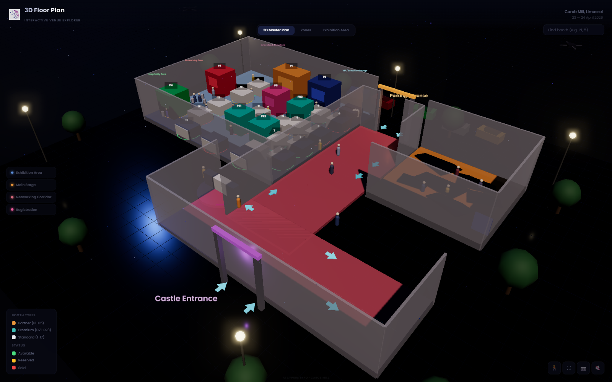
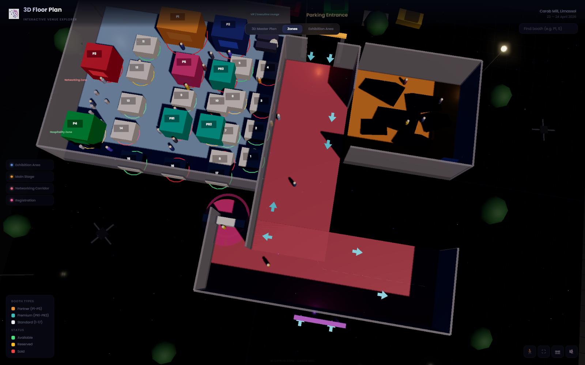
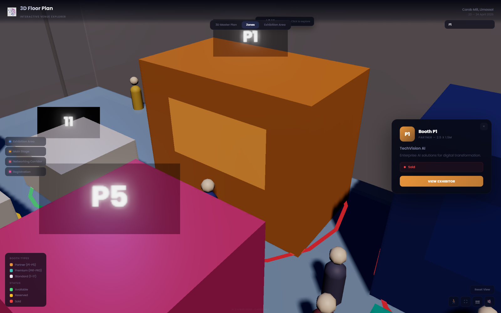

<div align="center">
  
  <h1>AI Cyprus Expo · Interactive 3D Floor Plan</h1>
  <p>A browser-based venue explorer for the Carob Mill in Limassol.</p>
  <p>
    
    
    
  </p>
</div>

Explore a detailed, interactive 3D model of an expo venue. Visitors can orbit the master plan, jump between venue zones, search for booths, and inspect exhibitor details and availability.

**[Open the live 3D floor plan ↗](https://hasan-99.github.io/ai-cyprus-expo-interactive-floor-plan/)**

## Screenshots

### 3D master plan



### Zones overview



### Booth details



## What you can do

- **Explore the venue in 3D.** Drag to orbit, scroll to zoom, and use the view tabs to switch between the master plan, zones, and exhibition area.
- **Jump to a zone.** Select Exhibition Area, Main Stage, Networking Corridor, or Registration to focus the camera on that part of the venue.
- **Find a booth.** Search by booth label, such as `P1`, `PR2`, or `5`.
- **Inspect exhibitors.** Select a booth to see its exhibitor description, size, and availability status.
- **Inspect venue zones.** Zone panels show a short description, sample visitor count, and sample occupancy.
- **Use the viewing tools.** Enter first-person view, toggle fullscreen or sound, capture a PNG of the current canvas, or reset the camera.

## Run locally

This is a static page with no install or build step. Serve the project directory over HTTP so the browser can load its JavaScript modules:

```bash
python -m http.server 8000
```

Then open [http://localhost:8000](http://localhost:8000). Stop the server with `Ctrl+C`.

You can also use any static file server, such as `npx serve .`. A modern browser with WebGL enabled is required.

## How it works

The experience is implemented in [`index.html`](index.html) using native HTML, CSS, and JavaScript modules. It imports Three.js 0.171 and its OrbitControls and post-processing modules from jsDelivr. Poppins is loaded from Google Fonts. The AI Cyprus Expo mark is bundled locally at [`assets/ai-cyprus-expo-favicon.png`](assets/ai-cyprus-expo-favicon.png), sourced from the [official event website](https://aicyprusexpo.com/).

No npm dependencies, bundler, server-side runtime, or build process are required. An internet connection is needed for the Three.js modules and Google Font; the logo itself is local.

## Demo data

This is a visual venue-explorer prototype. Booth companies, availability, visitor counts, occupancy, calls to action, and the displayed **23–24 April 2026** event date are values embedded in the page for demonstration. They are not live inventory or event updates. Confirm current event details with [AI Cyprus Expo](https://aicyprusexpo.com/) before relying on them.

## Project files

```text
.
├── assets/
│   └── ai-cyprus-expo-favicon.png
├── screenshots/
│   ├── venue-overview.png
│   ├── zones-overview.png
│   └── booth-detail.png
├── index.html
└── README.md
```

## Credits

The AI Cyprus Expo logo mark is from the official [AI Cyprus Expo website](https://aicyprusexpo.com/). This independent prototype is not an official ticketing, booking, or exhibitor-inventory service.
